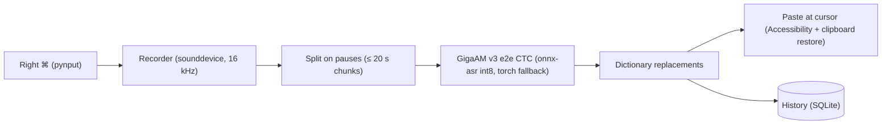

# GigaAM Dictation

[Русская версия](README.ru.md)


**Press right ⌘, speak, press it again — your words are typed where the cursor is. Fully local push-to-talk dictation for macOS, powered by Sber's GigaAM speech model. No cloud, no account, no telemetry.**

> Status: built and used daily on the author's Mac. The one-command installer (`install.sh`) has **not been tested on a clean machine** — see [Caveats](#caveats).

## Why

- **Private.** Audio never leaves your Mac. The internet is needed once, to download the model.
- **Good Russian.** GigaAM v3 (`e2e_ctc`) outputs punctuation and capital letters out of the box.
- **Light.** Default backend is int8 ONNX (no PyTorch): small memory footprint, runs partly on the Apple Neural Engine.
- **Works everywhere.** Types into any app: browser, messenger, IDE, terminal.

## Features

- Toggle recording with the **right ⌘** key; live level indicator in the bottom-right corner
- **Esc** cancels recording; **Esc** while "Recognizing…" stops pasting and saves text to history
- Text is pasted under the cursor; your previous clipboard is restored (optional)
- Long recordings (up to 5 min) are split on pauses and transcribed chunk by chunk
- History with search, re-paste, copy, delete
- Replacement dictionary ("how it sounds = how to write"), e.g. `ридми мд = README.md`
- Menu-bar icon, optional launch at login

## Quick start

```bash
git clone https://github.com/meshoklv/gigaam-dictation.git
cd gigaam-dictation
./install.sh
open GigaAM.app
```

`install.sh` creates a virtualenv, installs dependencies, downloads the model, builds `GigaAM.app` and installs a LaunchAgent that starts the app at login. Options: `--no-autostart`, `--with-torch` (extra PyTorch fallback backend, ~2 GB), `--python /path/to/python3`.

On first launch grant three permissions in *System Settings → Privacy & Security*: **Input Monitoring** (restart the app afterwards), **Accessibility**, **Microphone**.

Uninstall: `./uninstall.sh` (add `--purge` to also delete history, dictionary and the model cache).

Run from source without the bundle: `./run.sh`.

## Requirements

- macOS 13+ (Apple Silicon or Intel)
- Python 3.10+ (`brew install python@3.12`)
- ~1 GB of disk for the venv and model (more with `--with-torch`)

## How it works



Code lives in `app/` (PyQt6 UI, `asr.py` engine, `hotkey.py`, `recorder.py`, `inserter.py`, `dictionary.py`, `history.py`). Data is in `~/Library/Application Support/GigaAM-Dictation/` (`history.db`, `words.json`, `app.log`).

## Configuration

- Dictionary: copy `words.example.json` to `~/Library/Application Support/GigaAM-Dictation/words.json` (the installer does it) or edit it in the app's Settings.
- Environment variables: `GIGAAM_MODEL` (torch backend model name, default `v3_e2e_ctc`), `GIGAAM_DEVICE` (`auto`/`mps`/`cpu`).
- Bundle identifier is `com.example.gigaam-dictation` in `build_app.sh` — change it if you plan to sign the app.

## Caveats

- **Not verified on a clean Mac.** `install.sh`, `uninstall.sh` and the LaunchAgent were written and syntax-checked (`bash -n`) but never run end-to-end on a fresh machine. The dependency list in `requirements.txt` was reconstructed from the code's imports. Please open an issue if something breaks.
- The first ~5–10 s after launch the model warms up; early dictation waits automatically.
- Don't enable the in-app "launch at login" together with the LaunchAgent.
- UI strings are currently in Russian.

## License

MIT — see [LICENSE](LICENSE). Model and dependency licenses (note: PyQt6 is GPL-3.0) are in [THIRD_PARTY_NOTICES.md](THIRD_PARTY_NOTICES.md).
