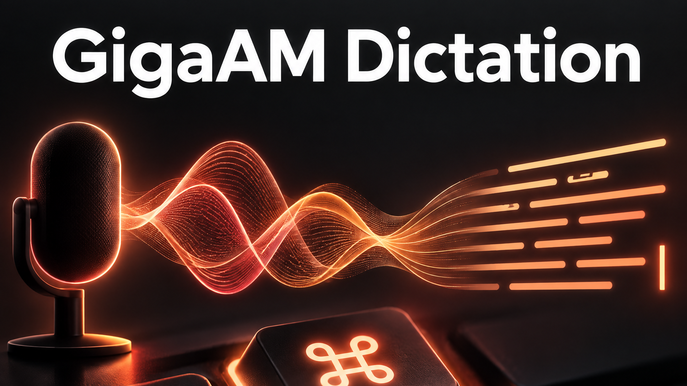
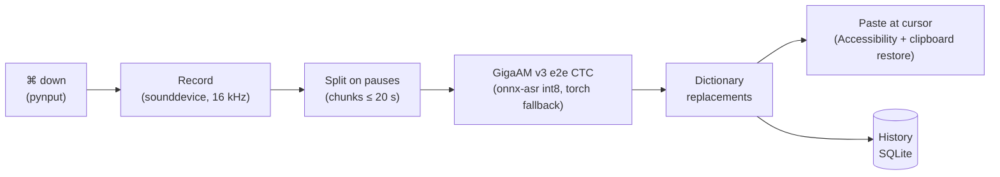

<p align="center">
  
</p>

<h1 align="center">GigaAM Dictation</h1>

<p align="center">
  <b>Press right ⌘, speak, press it again — your words appear in any text field on your Mac.</b><br>
  Fully offline push-to-talk dictation powered by Sber's GigaAM, the speech model built for Russian.
</p>

<p align="center">
  <a href="LICENSE"></a>
  
  
  
  
  
</p>

<p align="center">
  <a href="#-quick-start">Quick start</a> ·
  <a href="#-features">Features</a> ·
  <a href="#-how-it-works">How it works</a> ·
  <a href="README.ru.md">Русский</a>
</p>

---

## ✨ At a glance

| 🎙 Press | 🧠 Think | ⌨️ Type |
|---|---|---|
| Tap **right ⌘** in any app. A small pill in the corner shows a live level meter. | GigaAM v3 transcribes on your machine. Punctuation and capitals come straight from the model. | Text is pasted under the cursor, then your clipboard is put back. |

```text
⌘  "привет, это проверка диктовки, завтра в десять созвон"
   └──▶  Привет, это проверка диктовки, завтра в десять созвон.
```

> [!NOTE]
> Built and used daily on the author's Mac. The one-command installer has **not been tested on a clean machine** yet — see [Limitations](#-limitations).

## 💡 Why

- **Private by design.** Audio never leaves the Mac. The network is used once, to download the model.
- **Made for Russian.** GigaAM is trained for Russian speech and outputs punctuation and capital letters out of the box.
- **Light.** The default backend is int8 ONNX with no PyTorch, so memory use stays small.
- **Works everywhere.** It types into any app: browser, messenger, IDE, terminal.

### Compared with built-in macOS Dictation

Qualitative differences only — no benchmark numbers are claimed.

| | GigaAM Dictation | macOS Dictation |
|---|---|---|
| Runs fully offline | Yes, always (after the one-time model download) | Depends on language and system settings |
| Recognition model | GigaAM v3, open model built for Russian | Apple's model, chosen by the system |
| Custom replacements (`ридми мд` → `README.md`) | Yes, editable dictionary | No |
| History with search and re-paste | Yes | No |
| Source code you can read and change | Yes, MIT | No |
| Zero setup | No — needs Python and three permissions | Yes, built in |

## 🚀 Features

| | |
|---|---|
| 🎚 **One key** | Toggle recording with right ⌘; live level indicator in the bottom-right corner |
| ⎋ **Safe cancel** | Esc cancels a recording; Esc during "Recognizing…" stops pasting and keeps the text in history |
| 📋 **Clean paste** | Text lands under the cursor; your previous clipboard is restored (optional) |
| ⏱ **Long dictation** | Up to 5 minutes, split on pauses and transcribed chunk by chunk |
| 🗂 **History** | Search, re-paste, copy, delete |
| 📖 **Dictionary** | "How it sounds = how to write" replacements |
| 🍎 **Native feel** | Menu-bar icon, optional launch at login |

## ⚡ Quick start

```bash
git clone https://github.com/meshoklv/gigaam-dictation.git
cd gigaam-dictation
./install.sh
open GigaAM.app
```

`install.sh` creates a virtualenv, installs dependencies, downloads the model, builds `GigaAM.app` and installs a LaunchAgent that starts it at login.
Options: `--no-autostart`, `--with-torch` (extra PyTorch fallback backend, ~2 GB), `--python /path/to/python3`.

On first launch grant three permissions in *System Settings → Privacy & Security*: **Input Monitoring** (restart the app afterwards), **Accessibility**, **Microphone**.

| Requirement | |
|---|---|
| OS | macOS 13+ (Apple Silicon or Intel) |
| Python | 3.10+ (`brew install python@3.12`) |
| Disk | ~1 GB for the venv and model (more with `--with-torch`) |

<details>
<summary>Run from source, uninstall</summary>

```bash
./run.sh                 # run without building the .app bundle
./uninstall.sh           # remove app and LaunchAgent
./uninstall.sh --purge   # also delete history, dictionary and model cache
```
</details>

## 🔧 How it works



A global hotkey listener starts and stops the recorder. The audio is cut on pauses, each chunk goes through GigaAM, replacements are applied, and the result is pasted into the focused field. Every result is also stored in a local SQLite history.

Code lives in `app/` (PySide6 UI, `asr.py` engine, `hotkey.py`, `recorder.py`, `inserter.py`, `dictionary.py`, `history.py`). Data is in `~/Library/Application Support/GigaAM-Dictation/` (`history.db`, `words.json`, `app.log`).

## ⚙️ Configuration

| Setting | Default | Notes |
|---|---|---|
| `words.json` | created from `words.example.json` | Replacement dictionary; also editable in the app's Settings |
| `GIGAAM_MODEL` | `v3_e2e_ctc` | Model name for the torch backend |
| `GIGAAM_DEVICE` | `auto` | `auto` / `mps` / `cpu` |
| Bundle identifier | `com.example.gigaam-dictation` | Set in `build_app.sh`; change it if you sign the app |

## ⚠️ Limitations

> [!WARNING]
> **Tested on:** the author's Mac (daily use, before the PySide6 port).
> **Not yet tested on:** a clean Mac. `install.sh`, `uninstall.sh` and the LaunchAgent were syntax-checked (`bash -n`) but never run end to end on a fresh machine. The dependency list was reconstructed from the code's imports. The UI was ported from PyQt6 to PySide6 and import-checked on Linux only; it has not been launched on a Mac since the port.

- For the first ~5–10 s after launch the model warms up; early dictation waits automatically.
- Don't enable the in-app "launch at login" together with the LaunchAgent.
- UI strings are currently in Russian.

## 🤝 Contributing

Issues and pull requests are welcome — especially reports from clean-machine installs.

## 📄 License

MIT — see [LICENSE](LICENSE). The GUI uses PySide6 (LGPL). Model and dependency licenses are listed in [THIRD_PARTY_NOTICES.md](THIRD_PARTY_NOTICES.md).

---

<p align="center">Made by <a href="https://github.com/meshoklv">@meshoklv</a></p>
