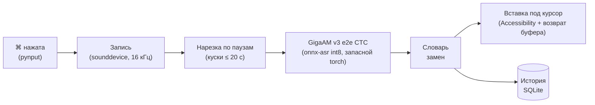

<p align="center">
  
</p>

<h1 align="center">GigaAM Диктовка</h1>

<p align="center">
  <b>Жмёшь правую ⌘ — говоришь — жмёшь ещё раз — текст появляется в любом поле на твоём Маке.</b><br>
  Полностью офлайн-диктовка на GigaAM от Сбера — модели, сделанной для русского языка.
</p>

<p align="center">
  <a href="LICENSE"></a>
  
  
  
  
  
</p>

<p align="center">
  <a href="#-быстрый-старт">Быстрый старт</a> ·
  <a href="#-возможности">Возможности</a> ·
  <a href="#-как-устроено">Как устроено</a> ·
  <a href="README.md">English</a>
</p>

---

## ✨ Коротко

| 🎙 Жмёшь | 🧠 Модель думает | ⌨️ Печатает |
|---|---|---|
| Тап по **правой ⌘** в любом приложении. В углу — плашка с живым индикатором уровня. | GigaAM v3 расшифровывает прямо на твоём Маке. Пунктуацию и заглавные ставит сама модель. | Текст вставляется под курсор, потом буфер обмена возвращается. |

```text
⌘  «привет, это проверка диктовки, завтра в десять созвон»
   └──▶  Привет, это проверка диктовки, завтра в десять созвон.
```

> [!NOTE]
> Проект работает у автора на его Маке каждый день. Установщик **на чистой машине пока не проверялся** — см. [Оговорки](#-оговорки).

## 💡 Почему

- **Приватно.** Звук не покидает Мак. Интернет нужен один раз — скачать модель.
- **Сделано для русского.** GigaAM обучена на русской речи и сразу ставит пунктуацию и заглавные буквы.
- **Лёгко.** Основной бэкенд — int8 ONNX без PyTorch, памяти нужно немного.
- **Везде.** Печатает в любое приложение: браузер, мессенджер, IDE, терминал.

### Сравнение со встроенной диктовкой macOS

Только качественные отличия, цифр точности не приводим.

| | GigaAM Диктовка | Диктовка macOS |
|---|---|---|
| Полностью офлайн | Да, всегда (после разовой загрузки модели) | Зависит от языка и настроек системы |
| Модель распознавания | GigaAM v3, открытая модель для русского | Модель Apple, выбирает система |
| Свои замены (`ридми мд` → `README.md`) | Да, словарь | Нет |
| История с поиском и повторной вставкой | Да | Нет |
| Исходный код, который можно читать и менять | Да, MIT | Нет |
| Ноль настройки | Нет — нужны Python и три разрешения | Да, уже встроена |

## 🚀 Возможности

| | |
|---|---|
| 🎚 **Одна клавиша** | Запись по правой ⌘, живой индикатор уровня в правом нижнем углу |
| ⎋ **Безопасная отмена** | Esc отменяет запись; Esc во время «Распознаю…» останавливает вставку, текст остаётся в истории |
| 📋 **Аккуратная вставка** | Текст встаёт под курсор, прежний буфер обмена возвращается (можно отключить) |
| ⏱ **Длинные записи** | До 5 минут: режутся по паузам и расшифровываются кусками |
| 🗂 **История** | Поиск, повторная вставка, копирование, удаление |
| 📖 **Словарь** | Замены «как звучит = как писать» |
| 🍎 **По-маковски** | Значок в меню-баре, автозапуск при входе |

## ⚡ Быстрый старт

```bash
git clone https://github.com/meshoklv/gigaam-dictation.git
cd gigaam-dictation
./install.sh
open GigaAM.app
```

`install.sh` создаёт venv, ставит зависимости, скачивает модель, собирает `GigaAM.app` и ставит LaunchAgent для автозапуска при входе.
Ключи: `--no-autostart`, `--with-torch` (запасной бэкенд на PyTorch, ~2 ГБ), `--python /путь/к/python3`.

При первом запуске дайте три разрешения в *Системные настройки → Конфиденциальность и безопасность*: **Мониторинг ввода** (потом перезапустите приложение), **Универсальный доступ**, **Микрофон**.

| Требования | |
|---|---|
| ОС | macOS 13+ (Apple Silicon или Intel) |
| Python | 3.10+ (`brew install python@3.12`) |
| Диск | ~1 ГБ под venv и модель (больше с `--with-torch`) |

<details>
<summary>Запуск из исходников, удаление</summary>

```bash
./run.sh                 # запуск без сборки .app
./uninstall.sh           # убрать приложение и LaunchAgent
./uninstall.sh --purge   # плюс история, словарь и кэш модели
```
</details>

## 🔧 Как устроено



Глобальный слушатель клавиши запускает и останавливает запись. Звук режется по паузам, каждый кусок идёт в GigaAM, затем применяются замены, и результат вставляется в активное поле. Каждый результат сохраняется в локальную историю SQLite.

Код — в `app/` (интерфейс на PySide6, движок `asr.py`, `hotkey.py`, `recorder.py`, `inserter.py`, `dictionary.py`, `history.py`). Данные — в `~/Library/Application Support/GigaAM-Dictation/` (`history.db`, `words.json`, `app.log`).

## ⚙️ Настройка

| Параметр | По умолчанию | Примечание |
|---|---|---|
| `words.json` | создаётся из `words.example.json` | Словарь замен; правится и в окне настроек |
| `GIGAAM_MODEL` | `v3_e2e_ctc` | Имя модели для torch-бэкенда |
| `GIGAAM_DEVICE` | `auto` | `auto` / `mps` / `cpu` |
| Идентификатор бандла | `com.example.gigaam-dictation` | Задан в `build_app.sh`; смените, если подписываете приложение |

## ⚠️ Оговорки

> [!WARNING]
> **Проверено:** на Маке автора (ежедневное использование, до перехода на PySide6).
> **Пока не проверено:** на чистом Маке. `install.sh`, `uninstall.sh` и LaunchAgent проверены только на синтаксис (`bash -n`). Список зависимостей восстановлен по импортам. Интерфейс перенесён с PyQt6 на PySide6 и проверен только импортом на Linux; на Маке после переноса не запускался.

- Первые 5–10 секунд после запуска модель прогревается; ранняя диктовка ждёт сама.
- Не включайте встроенный «Запускать при входе» вместе с LaunchAgent.
- Строки интерфейса пока только на русском.

## 🤝 Участие

Issues и pull request'ы приветствуются — особенно отчёты об установке на чистой машине.

## 📄 Лицензия

MIT — [LICENSE](LICENSE). Интерфейс использует PySide6 (LGPL). Лицензии модели и зависимостей — в [THIRD_PARTY_NOTICES.md](THIRD_PARTY_NOTICES.md).

---

<p align="center">Сделал <a href="https://github.com/meshoklv">@meshoklv</a></p>
