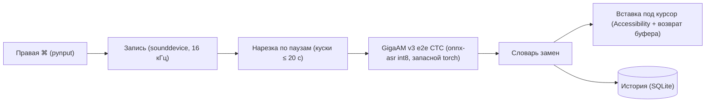

# GigaAM Диктовка

[English version](README.md)


**Жмёшь правую ⌘ — говоришь — жмёшь ещё раз — текст печатается там, где курсор. Полностью локальная диктовка для macOS на модели Сбера GigaAM. Без облака, аккаунтов и телеметрии.**

> Статус: проект работает у автора на его Маке. Установщик `install.sh` **на чистой машине не проверялся** — см. [Оговорки](#оговорки).

## Почему

- **Приватно.** Звук не покидает Мак. Интернет нужен один раз — скачать модель.
- **Хороший русский.** GigaAM v3 (`e2e_ctc`) сразу ставит пунктуацию и заглавные буквы.
- **Лёгко.** Основной бэкенд — int8 ONNX без PyTorch, мало памяти.
- **Везде.** Печатает в любое приложение: браузер, мессенджер, IDE, терминал.

## Возможности

- Запись по **правой ⌘**, живой индикатор уровня в правом нижнем углу
- **Esc** — отмена записи; **Esc** во время «Распознаю…» — остановить вставку, текст сохранится в истории
- Вставка под курсор, прежний буфер обмена возвращается (можно отключить)
- Длинные записи (до 5 минут) режутся по паузам и расшифровываются кусками
- История: поиск, повторная вставка, копирование, удаление
- Словарь замен («как звучит = как писать»), например `ридми мд = README.md`
- Значок в меню-баре, автозапуск при входе

## Быстрый старт

```bash
git clone https://github.com/meshoklv/gigaam-dictation.git
cd gigaam-dictation
./install.sh
open GigaAM.app
```

`install.sh` создаёт venv, ставит зависимости, скачивает модель, собирает `GigaAM.app` и ставит LaunchAgent (автозапуск при входе). Ключи: `--no-autostart`, `--with-torch` (запасной бэкенд на PyTorch, ~2 ГБ), `--python /путь/к/python3`.

При первом запуске дайте три разрешения в *Системные настройки → Конфиденциальность и безопасность*: **Мониторинг ввода** (потом перезапустите приложение), **Универсальный доступ**, **Микрофон**.

Удаление: `./uninstall.sh` (с `--purge` — ещё история, словарь и кэш модели). Запуск без бандла: `./run.sh`.

## Требования

- macOS 13+ (Apple Silicon или Intel)
- Python 3.10+ (`brew install python@3.12`)
- ~1 ГБ на диске под venv и модель (больше с `--with-torch`)

## Как устроено



Код — в `app/`. Данные — в `~/Library/Application Support/GigaAM-Dictation/` (`history.db`, `words.json`, `app.log`).

## Настройка

- Словарь: скопируйте `words.example.json` в `~/Library/Application Support/GigaAM-Dictation/words.json` (установщик делает это сам) или правьте в окне настроек.
- Переменные окружения: `GIGAAM_MODEL` (модель torch-бэкенда, по умолчанию `v3_e2e_ctc`), `GIGAAM_DEVICE` (`auto`/`mps`/`cpu`).
- Идентификатор бандла `com.example.gigaam-dictation` задан в `build_app.sh` — смените, если будете подписывать приложение.

## Оговорки

- **На чистом Маке не проверено.** `install.sh`, `uninstall.sh` и LaunchAgent написаны и проверены только на синтаксис (`bash -n`). Список зависимостей восстановлен по импортам в коде. Если что-то сломается — заведите issue.
- Первые 5–10 секунд после запуска модель прогревается.
- Не включайте встроенный «Запускать при входе» вместе с LaunchAgent.

## Лицензия

MIT — [LICENSE](LICENSE). Лицензии модели и зависимостей (PyQt6 — GPL-3.0) — в [THIRD_PARTY_NOTICES.md](THIRD_PARTY_NOTICES.md).
